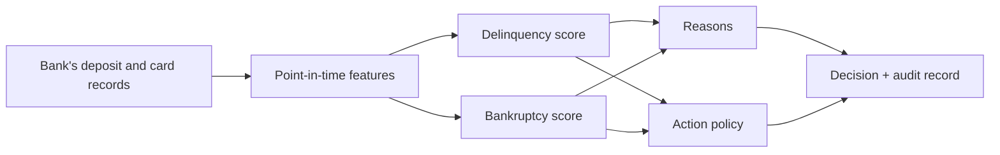

# Forewarn

> **Status: pre-pilot.** Everything works end to end and is tested, on **simulated** customers. No number below is evidence about a real portfolio. Scope is United States rules only. See [what is missing](docs/limitations-and-roadmap.md).

## What it does

Each month, for every open card account that is still current:

1. **Scores** the chance of reaching 60+ days past due within six months, and separately the chance of a bankruptcy filing within six months, from the bank's own deposit and card records.
2. **Explains** each score with up to four reasons taken directly from the scoring arithmetic.
3. **Recommends** a payment-date change, a hardship plan, a limit decrease, an outreach call, or nothing, and estimates what each is worth for that account.



## Five design choices, and what the reference run shows

Reference run: 94,201 simulated accounts over 54 months, bundle `a2fddd3c…`. Out-of-time window: 497,767 account-months that no model saw. Full tables: [`artifacts/report/results.md`](artifacts/report/results.md) and [`artifacts/report/validation_report.html`](artifacts/report/validation_report.html).

| # | Choice | How it is built | Measured on simulated data |
|---|---|---|---|
| 1 | **Early warning on existing customers, from the bank's own transactions** | 27 features from deposit and card ledgers: payroll gaps, shrinking balance buffer, overdrafts, minimum-payment drift. No bureau file, no open-banking feed | AUC 0.903 (0.897 to 0.910) against 0.846 with card data alone. Of 725 accounts that went from a clean year to 60+ days past due, 44% were flagged at least 75 days before the first missed payment and 17% at least 195 days. A card-only scorecard at the same alert rate: 13% and 11% |
| 2 | **Recommend the action, not only the score** | Per-action value models fitted on a randomized pilot; cross-fitted, valued by inverse propensity weighting | **Not shown to work.** Value models applied to every pilot account: $56 per account over no action, 95% interval −$22 to $127. The narrower rule the scorer actually ships (alerted accounts only): −$14, interval −$127 to $99. Both intervals include zero. Blanket hardship plans (−$269) and blanket limit decreases (−$129) do lose money |
| 3 | **Bankruptcy as its own target** | Separate model, same features, separate alert threshold | Of 372 filers, 54% were never 60 days past due in the year before filing. At the same 5% alert budget the bankruptcy score flagged 74% of those before they filed, the delinquency score 52% |
| 4 | **Governance evidence in the box** | Additive monotone models readable as tables; exact reason codes; validation report; fair-lending tests; drift monitoring; hash-chained audit log | Readable form costs 0.007 AUC (delinquency) and 0.019 (bankruptcy) against unconstrained boosting. 36 constrained terms, 0 monotonicity violations. Every sampled alert has at least one reason |
| 5 | **Runs inside the bank's account** | Go scorer on the standard library only, no outbound client; deny-all-egress manifests; model is one 66 KiB file pinned by SHA-256 | Go scorer matches the Python reference on 400 of 400 cases with zero difference on any logit. 16,000 accounts per second on two cores with the audit log on |

Three caveats that change how to read the table:

- The simulator encodes the distress mechanisms the models then find. Lift and lead time are properties of its parameters.
- The comparison model ("champion stand-in") has no credit-bureau data. A bank's real behaviour score is stronger, so real lift will be smaller.
- Row 2 is the weakest. The estimate is not stable: a separate 20,000-customer run (not included in `artifacts/`) put the unrestricted policy at −$107 per account (−$261 to $48). The evaluation machinery works and reports an inconclusive result as inconclusive. The recommendation layer needs a larger pilot, and on real accounts it needs a pilot at all.

## Quickstart

Requirements: Python 3.12+ (run on 3.13), Go 1.22+. On macOS, `brew install libomp` for LightGBM.

```bash
make setup     # Python dependencies
make demo      # 20,000 simulated customers, end to end, about a minute
open artifacts/report/validation_report.html
```

`make all` reproduces the reference run (100,000 customers, about 15 minutes, 5 GB of memory). `make test` runs both test suites.

Then score an account:

```bash
make serve     # 127.0.0.1:8080
curl -s localhost:8080/v1/score -H 'content-type: application/json' \
     -d @artifacts/bundle/example_request.json
```

```json
{
  "alert": true,
  "driver": "delinquency",
  "scores": {
    "delinquency": {
      "probability": 0.1767, "alert": true,
      "reasons": [
        {"code": "C02", "text": "Balance high relative to credit limit", "points": 1.997},
        {"code": "D06", "text": "Deposit balance low relative to monthly spending", "points": 1.392},
        {"code": "C11", "text": "Recent late payments", "points": 0.763},
        {"code": "C07", "text": "Number of months only the minimum payment was made", "points": 0.459}
      ]
    },
    "bankruptcy": {"probability": 0.0264, "alert": false, "reasons": ["..."]}
  },
  "action": {
    "recommended": "due_date_change",
    "note": "recommended",
    "estimated_gain": {"none": 0, "due_date_change": 423, "hardship_plan": 277, "outreach_call": 102, "limit_decrease": -150},
    "in_pilot_support": true,
    "adverse_action_notice": false
  },
  "bundle_sha256": "a2fddd3ce02b00920905b0cdf7823bf3b7a1e44f190e84b8fc6a6812a013919c"
}
```

(Trimmed. Points are log-odds added relative to the average account.)

Read the model itself:

```bash
bin/forewarn inspect -bundle artifacts/bundle/bundle.json | less
```

## Why a bank might buy this and not build it

It will not be for accuracy; any competent team gets within a couple of AUC points on the same data. The case rests on three things.

- **The data never leaves.** Training, validation and scoring run in the bank's account. The vendor sees nothing, which removes the hardest part of third-party review.
- **The evidence is already written.** The validation report, model card, reason-code logic, fair-lending tests, drift monitoring and implementation check exist on day one and regenerate for every model version.
- **The runtime enforces the documentation.** The scorer refuses a bundle that uses a prohibited feature, breaks a declared direction, reverses the score through calibration, or differs from the pinned digest. It refuses a request with an unknown feature or a missing required one.

Whether that is enough is a commercial question the code cannot answer. [docs/limitations-and-roadmap.md](docs/limitations-and-roadmap.md) lists the open ones.

## What the tests prove

| Claim | Test | How |
|---|---|---|
| Features use nothing from the future | `ml/tests/test_point_in_time.py` | Cuts every input off at a date, rebuilds, requires identical values. A one-month look-ahead planted during development made it fail |
| Feature definitions are what the docs say | `ml/tests/test_features.py` | A one-customer ledger worked out by hand |
| The simulator's books balance | `ml/tests/test_simulator.py` | Statement balances reconcile with posted transactions to within six cents (rounding per posted row) |
| The readable model is the trained model | `ml/tests/test_models.py` | Folded tables against the booster to 1e-9, missing values included |
| Decisions follow the documented rules | `ml/tests/test_pipeline.py` | No recommendation without an alert, outside pilot support, for an ineligible action, or below the minimum gain |
| The Go scorer equals the reference | `make verify`, `scorer/internal/engine` | Replays exported cases; fails on any difference |
| A bad bundle cannot be loaded | `scorer/internal/bundle` | Twelve ways to break a bundle, each rejected |
| Changes to the audit log are detectable | `scorer/internal/audit` | Edited, removed and reordered records break the chain. Records dropped from the end are caught only against a head hash kept elsewhere, which the batch summary records |

33 Python tests and the Go suite pass on the reference run.

## Repository

```
ml/forewarn/      pipeline: simulate, features, train, recommend, export, validate, report
ml/tests/         Python tests
scorer/           Go scorer: serve, batch, verify, inspect, audit-verify
deploy/           Dockerfile, Kubernetes manifests, reference Terraform (AWS)
docs/             architecture, data contract, operations, governance, limitations
artifacts/        reference run: model bundle, metrics, validation report, model card
```

| Document | For |
|---|---|
| [docs/architecture.md](docs/architecture.md) | How the pieces fit, with diagrams |
| [docs/data-contract.md](docs/data-contract.md) | The tables a bank maps its data into |
| [docs/operations.md](docs/operations.md) | Running, monitoring, deploying, releasing |
| [docs/governance/us-regulatory-map.md](docs/governance/us-regulatory-map.md) | Which US rule each control answers, and how far each statement was checked |
| [docs/governance/feature-policy.md](docs/governance/feature-policy.md) | Allowed, restricted and prohibited inputs |
| [docs/limitations-and-roadmap.md](docs/limitations-and-roadmap.md) | What is missing and the order to close it |

## Known limits

- Simulated data only. No real portfolio, no real pilot, no independent validation, no legal review.
- Card accounts only; United States federal rules only.
- The action layer's benefit is not established on the reference run. Where it recommended a limit decrease, accounts that got one did worse than those left alone (about 150 accounts a side, within the noise).
- Kubernetes manifests were syntax-checked only. The Terraform was not validated.
- No licence file is included. Decide the licence before sharing the repository.

## Engineering skills in this codebase

- **Go:** dependency-free HTTP service, strict configuration validation, tamper-evident logging, bit-exact numerics across amd64 and arm64
- **Python / ML:** point-in-time feature engineering, monotone gradient boosting folded into additive tables, calibration, cluster-bootstrap intervals
- **Causal inference:** randomized-pilot design, cross-fitted uplift models, off-policy evaluation with inverse propensity weighting
- **Model risk and compliance engineering:** reason codes, fair-lending tests, drift monitoring, validation reporting, feature policy enforced in code
- **Platform:** distroless container, restricted pod security, deny-all network policy, no-egress cloud perimeter
- **Testing:** leakage tests, accounting invariants, cross-language parity, mutation checks
