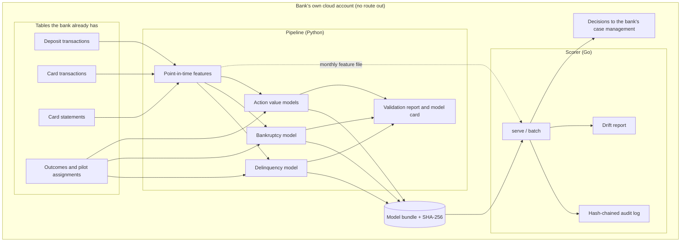
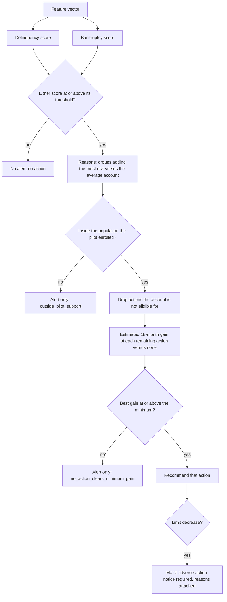
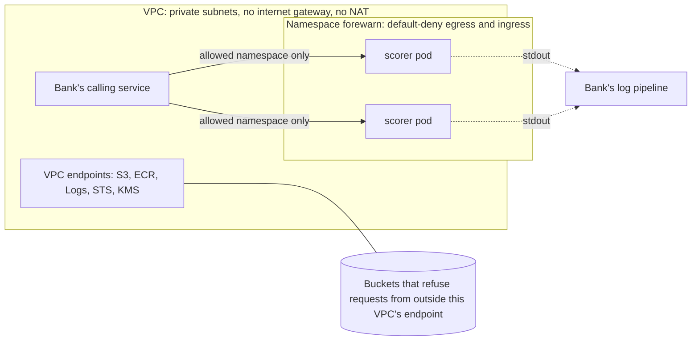

# Architecture

Forewarn has two halves that share one file.

- The **training and validation pipeline** (Python) runs where the bank keeps its data. It reads four tables, builds features, fits the models, and writes a model bundle plus the evidence a validator needs.
- The **scorer** (Go, standard library only) loads the bundle and turns one account's features into scores, reasons and a recommended action.

The bundle is a 60–70 KiB JSON file. Nothing else crosses from one half to the other.

## Data flow



## What happens to one account



Every decision, whatever the branch, is written to the audit log with the bundle digest and a digest of the input.

## Why the models are additive

Each risk score is

```
score = intercept + f1(x1) + f2(x2) + ... + fk(xk)
probability = sigmoid(a + b * score)
```

where every `f` is a lookup table. The tables come from gradient-boosted trees of depth one with monotone constraints; a sum of one-feature trees is a table per feature, so folding the trees loses nothing (`ml/tests/test_models.py` checks the folded model against the booster to 1e-9).

| Consequence | Where it shows up |
|---|---|
| The whole model can be read | `forewarn inspect` prints every table |
| Reasons are exact | A reason's points are the table values that were added to the score, not an estimate |
| Direction is enforced three times | Training constraint, validation report check, scorer refuses a non-monotone bundle |
| The scorer needs no ML library | A binary search per feature; identical results on amd64 and arm64 |
| Interactions are not modelled | The validation report measures the cost against unconstrained boosting |

## Repository layout

```
ml/forewarn/
  simulate.py    synthetic bank: ledgers, statements, outcomes, randomized pilot
  registry.py    feature list: direction, compliance status, reason statements
  features.py    point-in-time features and labels
  gam.py         additive monotone model: fit, fold into tables, calibrate
  train.py       two risk scores plus champion, card-only and unconstrained comparators
  recommend.py   action value models, cross-fitted off-policy evaluation
  score.py       reference implementation of the decision
  export.py      model bundle, digest, parity cases
  validate.py    out-of-time evidence
  report.py      validation report (HTML) and model card
scorer/
  cmd/forewarn/  serve, batch, verify, inspect, audit-verify
  internal/      bundle (strict loader), engine, drift, audit, server, batch
deploy/
  Dockerfile     distroless image, one static binary
  k8s/           restricted pod security, deny-all egress, pinned bundle digest
  terraform/aws  reference VPC with no internet route, endpoint-only buckets
docs/            this file, data contract, governance
```

## Deployment perimeter



Three independent controls keep customer data inside the account:

1. The scorer binary contains no outbound client (`make no-egress-check` fails the build if one appears).
2. The namespace denies all egress, DNS included.
3. The reference VPC has no route to the internet, and the buckets reject requests that do not arrive through its S3 endpoint.

The Kubernetes manifests were checked for syntax only. The Terraform has not been run through `terraform validate`; see the note at the top of `deploy/terraform/aws/main.tf`.
